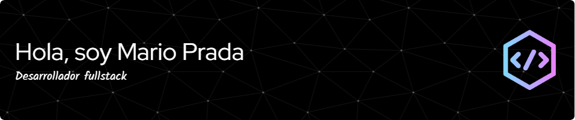

<h1 align="center">
  <b>Hola, soy Mario Prada 👋</b>
</h1>

<h3 align="center">
  Software Developer · AI & Big Data · Automation
</h3>

  

  
  
  

---

<h2>
  👨‍💻 Sobre mí
</h2>

- 🎓 Técnico Superior en **Desarrollo de Aplicaciones Multiplataforma (DAM)**.

- 🧠 Especializado en **Inteligencia Artificial y Big Data**.

- 💻 Desarrollo aplicaciones **Full Stack** utilizando principalmente **Angular, Python, FastAPI y PostgreSQL**.

- 🤖 Me interesa especialmente la **Inteligencia Artificial**, el análisis de datos y la **automatización de procesos**.

- 🚀 He desarrollado proyectos completos orientados a problemas reales, desde sistemas de gestión empresarial hasta herramientas de análisis de datos y aplicaciones basadas en IA.

- 🛠️ Actualmente trabajo en **MotorDesk**, un ERP desarrollado desde cero para talleres y concesionarios.

- 📊 También desarrollo proyectos relacionados con **Machine Learning, análisis de mercado, Big Data y automatización**.

- 💼 Busco oportunidades como **Software Developer**, **AI Developer**, **Big Data / Data Developer** o en proyectos de **automatización**.

- 📍 Sevilla, España · Disponible para oportunidades presenciales, híbridas y remotas.

 

---

<h2>
  🚀 Proyectos destacados
</h2>

### 🔧 MotorDesk

**ERP para talleres mecánicos y concesionarios**

Aplicación empresarial Full Stack diseñada para gestionar procesos reales de un taller y concesionario.

**Principales funcionalidades:**

- Gestión de clientes y vehículos.
- Órdenes de trabajo.
- Facturación y presupuestos.
- Gestión de stock y almacén.
- Pedidos a proveedores.
- Garantías.
- Agenda y citas.
- Gestión de usuarios, roles y permisos.
- Generación automática de PDF y códigos QR.
- Envío de documentación mediante WhatsApp y Email.
- Integración con sistemas de facturación y VERI*FACTU.

**Stack**

`Angular` · `TypeScript` · `Python` · `FastAPI` · `PostgreSQL` · `SQLAlchemy` · `Alembic` · `JWT` · `REST API`

---

### 📈 FC Market Intelligence

**Sistema de análisis de mercado y detección de oportunidades**

Proyecto desarrollado en Python para recopilar y analizar datos históricos de mercado, evaluar señales y detectar posibles oportunidades mediante métricas de rentabilidad.

**Características:**

- Históricos de precios.
- Catálogo automatizado de jugadores.
- Sistema de watchlist.
- Análisis de ROI.
- Seguimiento de señales.
- Evaluación automática de resultados.
- Persistencia mediante SQLite.
- Procesamiento asíncrono de datos.

**Stack**

`Python` · `SQLite` · `Data Analysis` · `AsyncIO` · `Algorithms`

---

### 🤖 Daiki AI

**Chatbot Full Stack basado en modelos de Inteligencia Artificial**

Aplicación conversacional desarrollada integrando modelos de lenguaje locales con una arquitectura frontend/backend.

**Características:**

- Integración con modelos LLM.
- Backend mediante API REST.
- Interfaz conversacional.
- Historial de conversaciones.
- Ejecución de modelos de IA en local.

**Stack**

`Python` · `FastAPI` · `Angular` · `Ollama` · `LLM`

🔗 [Ver proyecto](https://github.com/Marioph03/daiki-chatbot-inteligente)

---

### 🔐 LeakSentry

**Sistema de monitorización y detección de posibles filtraciones de información**

Plataforma orientada a ciberseguridad capaz de analizar fuentes, detectar coincidencias y evaluar riesgos automáticamente.

**Características:**

- Monitorización programada.
- Motor de evaluación de riesgo.
- Análisis automático de detecciones.
- Integración con diferentes fuentes y herramientas.
- Dashboard de resultados.

**Stack**

`Python` · `FastAPI` · `Angular` · `SQLAlchemy` · `APScheduler` · `Cybersecurity`

---

<h2>
  🧠 Tecnologías y herramientas
</h2>

<h3>💻 Lenguajes</h3>

  

<h3>🌐 Frontend</h3>

  

<h3>⚙️ Backend</h3>

  

<h3>🗄️ Bases de datos</h3>

  

<h3>🤖 AI & Data</h3>

  

`Machine Learning` · `Scikit-learn` · `Pandas` · `Apache Spark` · `Big Data` · `LLMs` · `Ollama` · `Power BI`

<h3>🛠️ Herramientas</h3>

  

---

<h2>
  📊 GitHub Stats
</h2>

  

  

  

---

<h2>
  🎯 Actualmente
</h2>

- 🔨 Mejorando y ampliando **MotorDesk**.
- 🤖 Experimentando con **IA generativa y modelos LLM**.
- 📊 Desarrollando sistemas de **análisis de datos y automatización**.
- 🚀 Buscando nuevas oportunidades profesionales dentro del sector tecnológico.

---

<h2>
  🤝 Contacto
</h2>

  

  

  

---

  <i>
    Siempre aprendiendo, construyendo y buscando nuevas formas de aplicar la tecnología a problemas reales.
  </i>

